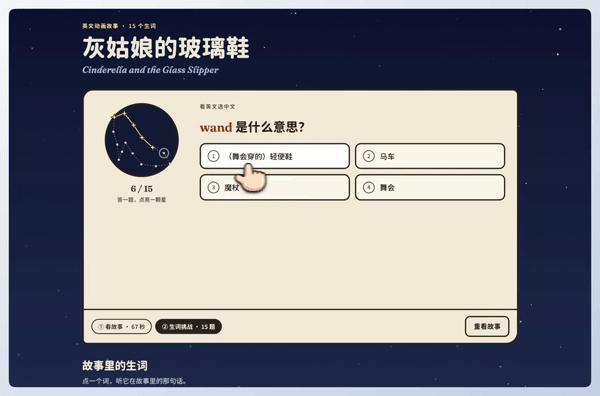

# 英语生词故事工作室

把一组英语生词编进短故事，生成带英文旁白和中英字幕的动画，再把视频、原句回听和生词选择题放进同一个互动网页。可选视频、网页或两者一起交付。



**成片预览**　《灰姑娘》生词故事与测验网页录屏。仓库内的 `preview/example.mp4` 保留完整画面和声音，可下载播放。

## 安装到 Codex 或 Claude Code

下列命令适用于已安装 Homebrew 的 macOS，在 zsh 终端中运行。选择 Codex 时使用下面的目录，选择 Claude Code 时把第一行改成 `SKILLS="$HOME/.claude/skills"`。两个工作室可共用 Python 环境和音效库。

```zsh
SKILLS="$HOME/.codex/skills"
export SK="$SKILLS/azhen-vocab-story-studio"
mkdir -p "$SKILLS"
git clone https://github.com/irenerachel/Azhen-Vocab-Story-Studio.git "$SK"
```

已有 Git 克隆的用户可在该目录执行 `git pull --ff-only` 更新。也可从 GitHub 的 **Code → Download ZIP** 下载，解压后将包含 `SKILL.md` 的整个目录放到上面的 `$SK` 位置。安装后开启新会话，用中文描述任务即可。

```text
用英语生词故事工作室，把 slipper、pumpkin、carriage、midnight 编成一个英语小故事。做横版动画和互动测验网页，配中英双语字幕。
```

## 获取渲染器和音效

仓库的 `renderer/` 已包含逐帧渲染器、抽帧预览工具、成片检查脚本和音效下载清单。上面的克隆和 ZIP 都包含这些文件。首次运行需要联网安装软件、浏览器和音效。

```zsh
brew install ffmpeg node uv
export PY="$HOME/.venvs/vocab-story/bin/python"
[[ -x "$PY" ]] || uv venv --python 3.11 "$HOME/.venvs/vocab-story"
uv pip install --python "$PY" faster-whisper numpy pillow scipy scikit-image fonttools brotli

export CTV="$SK/renderer"
"$PY" "$CTV/scripts/sound_library.py" fetch
"$PY" "$CTV/scripts/sound_library.py" verify
zsh "$SK/scripts/doctor.sh"
```

音效默认存入 `~/Documents/Codex/素材库/code-to-video-sounds`。如要换盘，在运行上述音效命令前设置 `export CTV_SOUND_LIB="/你的音效库目录"`。下载中断可以重跑 `fetch`，然后用 `verify` 检查。音效来源见 `renderer/assets/SOUND-LICENSES.md`。Whisper small 模型会在首次使用语音对齐时下载。

已有完整 `code-to-video-studio` 的用户可以将 `CTV` 设为它的绝对路径。未设置时，脚本依次查找 Codex 的 skills 目录、Claude 的 skills 目录、当前仓库的 `renderer/`。运行 `zsh "$SK/scripts/renderer_path.sh"` 可查看实际路径。手动渲染时，在同一个终端保留 `SK`、`PY`、`CTV` 三个变量。

## 从项目到成片

1. 在终端创建工程。脚本会安装项目自己的 npm 依赖和 Playwright Chromium。`P` 可改为自己的项目目录，最后一个参数可选 `16:9` 或 `9:16`。

```zsh
export P="$HOME/Documents/vocab-story-demo"
zsh "$SK/scripts/new_project.sh" "$P" 16:9
cd "$P"
export PLAYWRIGHT_MODULE="$P/node_modules/playwright"
```

2. 把工程目录交给 Agent，按 `SKILL.md` 完成脚本、插画、配音和时间轴。参照 `assets/example-cinderella/` 的故事、旁白与题库结构。先确认词表和英文故事，再生成分层素材并对齐英文配音。四选一测验至少准备四个词。 初始化生成的是工程骨架，下面的导出步骤用于素材已就绪的工程。

3. 在工程目录抽帧预览，检查字幕、人物位置和遮挡，然后导出旁白时间轴。

```zsh
node "$CTV/scripts/preview.mjs" page 8
node "$SK/scripts/export_timeline.mjs" .
```

4. 渲染页面并混入配音。逐帧画面和音效混音位于 `build/v1/`。

```zsh
node "$CTV/scripts/render_page.mjs" page --out build/v1
"$PY" "$SK/scripts/mix_voice.py" . build/v1/output/page.mp4 build/v1/mix-page.wav "成片/story.mp4"
"$PY" "$CTV/scripts/check_video.py" "成片/story.mp4" --sheet "成片/contact-sheet.png"
```

最终视频和字幕分别是 `成片/story.mp4` 与 `成片/story.srt`。遇到浏览器缺失，在工程目录运行 `npx playwright install chromium`；遇到音效缺失，检查 `CTV_SOUND_LIB` 并重新运行音效校验。

## 生成互动测验网页

在工程中先准备 `web/quiz-data.json`、题图与每句英文配音。示例题库位于 Skill 的 `assets/example-cinderella/quiz-data.json`，其中的词、原句和图片编号须换成当前故事的内容。

```zsh
"$PY" "$SK/scripts/web_assets.py" "$P" "$P/成片/story.mp4"
"$PY" "$SK/scripts/build_quiz.py" web/quiz-data.json web/index.html --local
"$PY" -m http.server 8765 --bind 127.0.0.1 --directory web
```

在浏览器打开 `127.0.0.1:8765/_local.html`，播放视频、答题并回听原句。发布时保留 `web/index.html`、视频、字体、图片和音频的相对位置。
